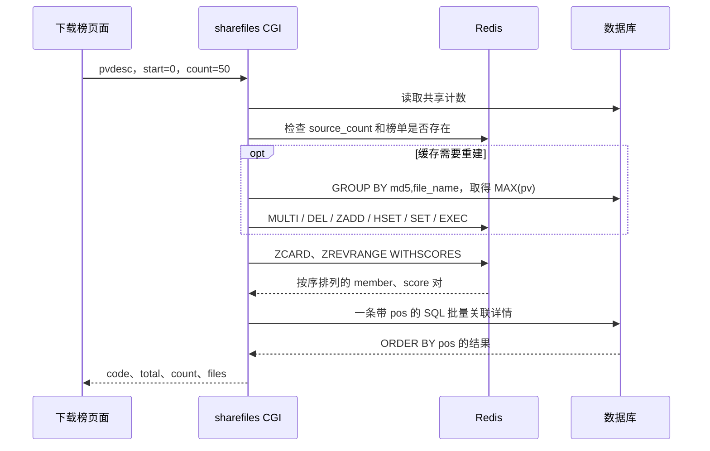

# 热门文件排行榜：结合项目代码的面试梳理

依据 2026-10-22 工作区代码、原版对照及已有压测报告。本轮进行代码解读与原始数据复算，没有修改业务实现或重新运行远程压测。示例的 A/B 和文件名是说明用的占位数据。

## 1. 简历这句话到底说明什么

项目原来就用了 Redis ZSet。此次改进的中心是：取到榜单成员后，消除逐条补查文件名、分数和详情的访问，并在批量关联详情时保留 Redis 顺序。

可以这样开场：

> 我的云存储项目有公开共享文件下载榜。Redis 保存共享文件的排序索引和下载热度，数据库保存分享记录和文件元数据。原实现取到一批榜单成员后，循环查文件名、分数和详情，50 条会执行 50 次详情 SQL。我用 WITHSCORES 一次取得有序成员和分数，再构造带位置的派生表，用一条 SQL 关联全部详情，最后按原位置返回。隔离环境的预热 HTTP 测试中，P95 从 34.95 ms 降到 6.92 ms。

必须区分：

- `50 → 1` 指非空批次的详情 SQL；请求仍有共享计数查询，冷缓存另有重建查询。
- `1,000 条`是构造的共享记录数，`1,000 次`是每个对照端点的采样请求数。
- `并发 4`是线程池并发上限，不是每秒 4 次，也不是 1,000 个并发。
- 当前页面一次取 50 条，表格每页显示 10 条。“每批 50 条”比“每页 50 条”更贴近实际页面。
- `降低约 80%`指该条件下 P95 延迟的下降，不能据此声称生产吞吐或最大并发提升同样比例。

## 2. 业务数据各自负责什么

| 位置 | 主要内容 | 下载榜用途 |
|---|---|---|
| `user_file_list` | 用户关联、分享状态、用户侧 PV | 私人文件列表与分享入口 |
| `share_file_list` | user、md5、file_name、pv、分享时间 | 判断仍然公开分享，取得分享者等信息 |
| `file_info` | md5、FastDFS ID、URL、大小、类型 | 提供展示和下载用元数据 |
| `user_file_count` | 特殊用户 FILE_PUBLIC_COUNT 对应共享记录计数 | 辅助判断缓存是否需要重建 |
| Redis `FILE_PUBLIC_ZSET` | member = md5 + file_name；score = PV | 排序、范围查询和热度 |
| Redis `FILE_NAME_HASH` | member 到文件名的映射 | 旧查询逐条读取，新查询不再逐条依赖 |
| Redis `FILE_PUBLIC_ZSET:source_count` | 上次重建对应的数据库共享记录计数 | 有效性标记，缺失会触发重建 |

证据：[redis_keys.h](C:/Users/puppy/Desktop/AI_YunCunChu/include/redis_keys.h:12)、[表定义](C:/Users/puppy/Desktop/AI_YunCunChu/docker/mysql/init.sql:12)。

### member 为什么是 MD5 加文件名

榜单按 `(md5,file_name)` 区分成员：同内容、不同名可以是两个成员；同内容、同名字折叠成一个 member。前 32 字节固定属于十六进制 MD5，因此可以分离前缀和文件名后缀。这是榜单业务标识，不能把它叫作 FastDFS 的物理文件 ID。

正常分享入口会检查同内容同名称是否已公开分享，但数据库没有 `(md5,file_name)` 唯一约束，并发或旧数据可能留下重复分享记录。新版读取对这种情况做了归并与代表行选择。证据：[share_file](C:/Users/puppy/Desktop/AI_YunCunChu/src_cgi/dealfile_cgi.c:250)。

## 3. 从页面到后端的实际流程

[TopDownloads.js](C:/Users/puppy/Desktop/AI_YunCunChu/picture_bed/src/pages/TopDownloads.js:35) 调用：

```javascript
const result = await fetchSharedFilesRanking(0, 50);
setTopFiles(result.files || []);
```

[share.js](C:/Users/puppy/Desktop/AI_YunCunChu/picture_bed/src/services/share.js:28) 发出：

```http
POST /api/sharefiles?cmd=pvdesc
Content-Type: application/json

{"start": 0, "count": 50}
```

CGI `main()` 命中 pvdesc 后调用 `get_ranking_filelist(start,count)`，见 [sharefiles_cgi.c](C:/Users/puppy/Desktop/AI_YunCunChu/src_cgi/sharefiles_cgi.c:618)。



这里返回的是文件元数据和 URL，榜单接口不下载 50 份文件内容。

## 4. 旧版慢在哪里

对照实现见 [baseline](C:/Users/puppy/Desktop/AI_YunCunChu/tests/baseline/sharefiles_cgi.c:547)。按实际代码提炼的伪代码：

```c
members = ZREVRANGE(key, start, start + count - 1);
for (int i = 0; i < n; ++i) {
    filename = HGET(FILE_NAME_HASH, members[i]);
    pv = ZSCORE(FILE_PUBLIC_ZSET, members[i]);
    detail = query_one_file(md5_prefix(members[i]), filename);
    append_json(detail, pv);
}
```

问题不是 for 循环本身，而是每次循环都同步访问外部服务：

| 非空 50 条批次的工作 | 旧版 | 新版 |
|---|---:|---:|
| 取成员 | 1 次 ZREVRANGE | 1 次 ZREVRANGE WITHSCORES |
| 补文件名 | 50 次 HGET | 从 member 后缀取得查询键，响应字段取批量 SQL |
| 补分数 | 50 次 ZSCORE | 使用 WITHSCORES 结果 |
| 补详情 | 50 次详情 SQL | 1 次详情 SQL |

不含缓存检查、计数、连接和重建操作。可表述为“消除类似 N+1 的串行访问，减少网络、协议和重复执行开销”；本地组装 JSON 仍需遍历这一批数据。

本次压测比较的是新版与基线的整条实现路径，连接、JSON 输出等也有差异。没有单变量消融实验，不能把 80% 精确拆成某条修改的贡献。

## 5. 关键点一：WITHSCORES 一并取顺序和热度

实际代码在 [sharefiles_cgi.c](C:/Users/puppy/Desktop/AI_YunCunChu/src_cgi/sharefiles_cgi.c:472)：

```c
rank = redisCommand(r, "ZREVRANGE %s %d %d WITHSCORES",
                    FILE_PUBLIC_ZSET, start, start + count - 1);
size_t n = rank->elements / 2;
```

代码检查回复类型、元素数为偶数且不超过请求数量。当前 hiredis/RESP2 路径的返回形式可理解为：

```text
[memberA, "125", memberB, "103", memberC, "81"]
```

```c
redisReply *member = rank->element[i * 2];
redisReply *score  = rank->element[i * 2 + 1];
```

面试重点：

1. 范围索引从 0 开始，结束位置包含在内，因此 50 条是 `0..49`。
2. WITHSCORES 省去逐条 ZSCORE，使本次榜单顺序和展示分数来自同一次 Redis 读取。
3. 代码没逐条调用 ZREVRANK，排名由返回位置体现；后端 JSON 没有单独的 rank 字段。
4. 此处热度是 PV，没有时间衰减、点赞权重或推荐公式。

Redis 7.0 官方命令定义给出的复杂度是 `O(log N + M)`，M 为返回成员数。Redis 6.2 起推荐替代写法 `ZRANGE key start stop REV WITHSCORES`；旧命令仍可在项目测试用的 Redis 7.0.15 上运行。命令名称迁移并非本次性能改进的来源。

## 6. 核心难点：批量 SQL 如何保序和配分数

假设 Redis 返回 A、B、C，分数是 125、103、81。SQL 的 IN 参数列表不是结果排序约定。如果数据库返回 C、A、B，却仍按数组下标配分数，就会错配。你的键还包含名称，单独按 md5 匹配会丢失这一维度。

### 你的实现是带 pos 的 UNION ALL 派生表

构造见 [sharefiles_cgi.c](C:/Users/puppy/Desktop/AI_YunCunChu/src_cgi/sharefiles_cgi.c:482)。以下两行示例保持实际 SQL 结构，MD5 和名称用占位值：

```sql
SELECT ranked.pos, s.user, f.url, f.size, f.type,
       s.create_time, s.md5, s.file_name
FROM (
    SELECT 0 AS pos, 'md5_A' AS md5, 'A.pdf' AS name
    UNION ALL
    SELECT 1 AS pos, 'md5_B' AS md5, 'B.zip' AS name
) ranked
JOIN share_file_list s
  ON s.id = (
      SELECT MIN(s2.id) FROM share_file_list s2
      WHERE s2.md5 = ranked.md5 AND s2.file_name = ranked.name
  )
JOIN file_info f ON f.md5 = s.md5
ORDER BY ranked.pos;
```

- `ranked`：在本次查询中把 Redis 成员表示成关系表；没有创建持久化临时表。
- `pos`：本批次内的位置，0 对应本次 Redis 返回的第一条，不是永久全局名次。
- `(md5,name)`：匹配具体共享成员，兼顾同内容不同名称。
- `MIN(id)`：重复分享记录中选 ID 最小的一条作为代表，避免一名成员关联出多条详情。
- `JOIN file_info`：补 URL、大小和类型，ZSet 不需要装下全部详情。
- `ORDER BY pos`：明确恢复 Redis 顺序。

冷重建采用同一分组的 MAX(pv)，详情采用 MIN(id) 代表行，因此重复数据下分享者与热度可能不来自同一行。这是当前规则，不是每个用户独立排名。

虽然 SQL 内有相关子查询，应用只提交一个详情查询；数据库仍需做多次索引匹配。一次往返不等于只访问一行或 O(1)。表上已有 `idx_share_content_name(md5,file_name)` 和 `file_info.uq_md5(md5)`，见 [表索引](C:/Users/puppy/Desktop/AI_YunCunChu/docker/mysql/init.sql:22)。规模增大后应结合 EXPLAIN 和实测评估。

### 用返回的 pos 找回对应分数

组装代码在 [sharefiles_cgi.c](C:/Users/puppy/Desktop/AI_YunCunChu/src_cgi/sharefiles_cgi.c:510)：

```c
size_t pos = strtoul(row[0], NULL, 10);
cJSON_AddNumberToObject(item, "pv",
    strtod(rank->element[pos * 2 + 1]->str, NULL));
cJSON_AddItemToArray(files, item);
```

用 SQL 返回的 pos 访问 Redis 原始 score。即使中间一条详情被删除，后面成员也能取到自己的分数，避免缺行造成整体错位。

## 7. 关键点二：缓存校验、重建和脏成员

### 缓存有效路径

[sharefiles_cgi.c](C:/Users/puppy/Desktop/AI_YunCunChu/src_cgi/sharefiles_cgi.c:403) 读取共享计数 published，检查 source_count 与它相同，并且榜单存在，或 published 本来就是 0。满足条件就使用现有缓存，否则查询：

```sql
SELECT md5,file_name,MAX(pv)
FROM share_file_list
GROUP BY md5,file_name;
```

保存源计数，可以避免数据库重复分享行数与 ZSet 去重成员数不同而反复重建。但计数仅是启发式标记：等量替换成员、纯分数偏差、部分成员丢失等问题，不一定能被发现。

### MULTI/EXEC 解决什么

旧版删除 key 后逐条填充，其他请求可能看到空榜单或半成品。新版排队执行 DEL、全部 ZADD/HSET、SET source_count，再 EXEC。正常成功执行时，其他客户端命令不会插入事务的执行过程，避免删后逐步填充的可见窗口。

Redis 事务没有数据库式执行期回滚，也没有涵盖此前的数据库读取。不能把这个改进解释为 MySQL 与 Redis 的共同事务。当前逐条命令还同步等待 QUEUED，未使用 pipeline，也没有防止多个冷请求同时重建。

因此进一步可讨论重建互斥、版本校验、临时 key 切换与补偿，但这些不是当前已实现的功能。

### member 有了，详情却没有

INNER JOIN 会跳过已不在分享表或元数据表中的成员。当前代码发现 returned 小于本批成员数时，删除 source_count，让后续请求重建，见 [528 行](C:/Users/puppy/Desktop/AI_YunCunChu/src_cgi/sharefiles_cgi.c:528)。

```c
if (returned != (int)n) {
    redisReply *a = redisCommand(r, "DEL %s:source_count", FILE_PUBLIC_ZSET);
    if (a) freeReplyObject(a);
}
```

本次没有逐条补查或继续补满；count 为实际返回数，可能不足 50。total 来自本次 ZCARD，失效窗口内可能仍包含脏成员。Redis 连接失败则走失败响应，没有自动回退到数据库排序。

## 8. 热度如何随下载变化

[handleDownload](C:/Users/puppy/Desktop/AI_YunCunChu/picture_bed/src/pages/TopDownloads.js:48) 先调用 pvSharedFile，捕获计数失败后仍触发浏览器下载，随后刷新排行榜。

请求是 `/dealsharefile?cmd=pv`，[pv_file](C:/Users/puppy/Desktop/AI_YunCunChu/src_cgi/dealsharefile_cgi.c:121) 先读旧 PV，再执行：

```sql
UPDATE share_file_list SET pv = pv + 1
WHERE md5 = '...' AND file_name = '...';
```

Redis member 存在时，底层使用 `ZINCRBY FILE_PUBLIC_ZSET 1 member`；不存在时，用此前读到的旧 PV 加 1 重新 ZADD，同时写名称 Hash。

需要讲清：

- 数据库表达式自增避免应用读旧值后写固定新值的覆盖问题；SELECT 出的旧 PV 仍被用于缓存缺失分支。
- 单次 ZINCRBY 原子，不代表整个数据库加 Redis 双写原子。
- 缓存缺失分支旧 PV 加 1 的写入及缓存重建，可能覆盖并发产生的较新 score。
- PV 在浏览器发起下载之前更新，代表下载触发，不代表文件完整下载成功。直接访问 URL 也不自动调用此接口。
- 当前没有完整防刷、重试对账与补偿闭环，不能保证所有故障后的自动收敛。

### 已识别的实际代码问题：ZINCRBY 返回值判断

[redis_op.c](C:/Users/puppy/Desktop/AI_YunCunChu/common/redis_op.c:1284) 当前写法：

```c
reply = redisCommand(conn, "ZINCRBY %s 1 %s", key, member);
if (strcmp(reply->str, "OK") != 0) {
    retn = -1;
    goto END;
}
```

ZINCRBY 正常返回更新后的分数，RESP2 是类似 `"126"` 的字符串，不是 `"OK"`。因此真实增分可能成功，封装却误报失败；还缺少 reply 空指针检查。这是读取优化之外的已有缺陷，本轮未修复。被问后续计划时，应先讲修正返回类型与异常检查，再验证并发更新和失败补偿。

## 9. 面试容易忽略的业务与边界

- 读取函数限制 start 非负、count 为 1..100，检查整数溢出，见 397 行；50 是常用批次，并非接口只允许 50。
- 动态 SQL 使用 mysql_real_escape_string 转义键并检查主要拼接段长度。当前不是参数化预编译查询。
- member 校验最多 160 字节，而文件名列按字符计长；多字节名称可能遇到更严格的实际限制，需要单独测试。压测夹具是 ASCII 名称。
- 同分按 Redis member 逆字节字典序排列，当前没按分享时间打破平局。
- 跨请求使用 start/count 时，实时热度变化可能造成跨页重复或漏看；没有快照或游标协议。
- 页面取前 50 后每页展示 10 条，排名列用 index+1，后端没返回全局 rank。不能承诺当前实现对任意后端分页都显示全局名次。

## 10. 80% 的证据和测试口径

入口：[压测脚本](C:/Users/puppy/Desktop/AI_YunCunChu/tools/benchmarks/verify_and_measure.py:145)、[最终原始数据](C:/Users/puppy/Desktop/AI_YunCunChu/reports/optimization/final-measurements.json:63)、[方法与全部轮次](C:/Users/puppy/Desktop/AI_YunCunChu/reports/optimization/README.md:45)、[复测脚本](C:/Users/puppy/Desktop/AI_YunCunChu/tools/benchmarks/repeat_ranking.py:24)。

2026-10-19 最终报告的环境是 4 vCPU、约 3.6 GiB 内存，数据库实际为 MariaDB 10.11.14，Redis 7.0.15、nginx 1.24.0，真实 CGI 和数据库服务。

脚本构造 1,000 条记录，ASCII 名称类似 rank_0000.bin，PV=10000-i，所以该数据集没有同分；URL 是夹具值，不测试文件内容下载。

| 项目 | 设置 |
|---|---|
| 请求 | baseline 与优化版 pvdesc；start=0,count=50 |
| 样本 | 每端点 1,000 次 |
| 并发 | 线程池最多 4；双方各 4 个 CGI worker |
| 预热 | 每端点 30 次，不计入样本 |
| 顺序 | 每 50 次为一块，交替并轮换前后顺序 |
| HTTP | 服务器本机 loopback，每次新连接 |
| 计时 | 发请求前开始，完整响应读取结束 |
| 错误 | 单独计数，最终主轮和三轮复测均为 0 |

SQL 条数在单独阶段通过数据库 general log 实际统计，过滤应用账号和详情 SELECT 前缀，断言 50 和 1；随后关闭 general log 再测延迟，见脚本 161..170 行。这不是全请求所有 SQL 的数量。

正确性检查：两版 count 都为 50，逐项比较 `(md5,file_name,pv)`，验证 PV 降序。未逐个比较全部详情字段，也未覆盖同分、重复分享、脏成员及持续并发写入等全部场景。

将每端点 1,000 个延迟排序，取第 ceil(1000*0.95)=950 个，即下标 949：

```text
原版 P95 = 34.947117 ms
新版 P95 =  6.916366 ms
降幅 = (34.947117 - 6.916366) / 34.947117 = 80.209051%
```

本轮从两组原始 1,000 个样本重新核对了上述结果。P95 不是最大值，也不是平均值，更不表示每个请求都按同比例提速。

三轮独立复测 P95 为 33.36→6.63、34.71→6.90、37.73→7.46 ms。首轮 500 次采样还曾出现 32.82→46.11 ms，原因未确定，报告保留了数据。不能没有证据地把异常归因于某个缓存或系统因素，也不能将这些预热、小并发、本机测试推广为线上或高并发极限。

## 11. 高频追问的回答骨架

**为什么用 ZSet？** 业务要按 PV 排序、自增分数并取前 50。ZSet 直接表达 member-score 和有序范围；Set 不提供该分数排序，List 不直接支持更新任意成员分数后维持排名。项目原来已有 ZSet，这次是改进它后面的读取路径。

**是不是把 50 个 SQL 用分号拼起来？** 不是，实际是一条 SELECT，用 UNION ALL 派生表表达全部目标，再关联详情。相关子查询是数据库内部执行工作，不是应用发出了 50 次请求。

**为什么不用 IN？** IN 加结果映射、按 Redis 顺序组装也是可行方案。当前实现选择携带 pos 并显式 ORDER BY，不能靠 IN 参数顺序保证结果顺序。

**为什么不用数据库直接 ORDER BY pv DESC LIMIT 50？** 这是合理备选，尤其 1,000 条数据应按索引和负载实测。当前证据支持新版优于逐条补详情的基线，没有证明它一定优于设计合理的纯数据库查询。

**50 次变 1 次，为什么不是降低 98%？** 查询次数和端到端时间不成等比；连接、计数、Redis、批量 SQL、自身结果处理和 HTTP 仍有成本，而且比较的是整个实现路径。延迟必须实测。

**如何保证缓存强一致？** 当前没有。Redis 单条命令原子和重建事务发布解决局部问题，数据库与 Redis 双写及读取之间仍有时间窗口。没有完整补偿闭环，应如实说明。

**如果数据被删除怎么办？** 批量 JOIN 查不到时跳过、删除有效标记，后续重建；本次不保证补满，也不逐条回退查询，避免重新引入串行访问。

**下一步优先做什么？** 修正 ZINCRBY 返回值判断，补并发双写、重建覆盖、同分、中文长名称和脏缓存测试；再按规模评估重建互斥、版本发布、对账补偿和分批加载。这些是后续计划。

## 12. 可直接口述的一分钟回答

> 我做的是公开共享文件下载榜，页面一次取前 50 条。Redis member 是 MD5 加文件名，score 是下载触发次数，数据库保存分享信息和文件元数据。原来已经用了 ZSet，但取榜单后还逐条 HGET 文件名、ZSCORE 分数和查详情，所以 50 条有 50 次详情 SQL。
>
> 我改成 ZREVRANGE WITHSCORES 一次拿到有序成员及分数，为每个成员附加 pos，通过 UNION ALL 派生表批量关联分享表和文件表，ORDER BY pos。组装 JSON 时用 pos 找原始 score，避免顺序和分数错配。详情缺失则跳过并失效缓存标记，让后续重建。
>
> SQL 次数通过数据库 general log 验证。真实 HTTP 对照测试是 1,000 条共享记录、每批 50 条、并发 4、每端点 1,000 次，预热后 P95 从 34.95 ms 到 6.92 ms，降低约 80%。这是隔离环境的结果，当前双写仍有一致性边界，没有宣称强一致或高并发极限。

### 官方语义追溯

本轮取得 Redis 7.0 官方命令定义，核对范围查询复杂度和替代写法。其余命令及事务细节可按下列官方地址追溯：

```text
https://raw.githubusercontent.com/redis/redis/7.0/src/commands/zrevrange.json
https://raw.githubusercontent.com/redis/redis/7.0/src/commands/zincrby.json
https://redis.io/docs/latest/commands/zincrby/
https://redis.io/docs/latest/develop/using-commands/transactions/
```
